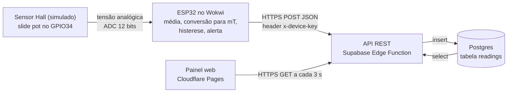

# Sensores para a Segurança Residencial

Monitoramento IoT de abertura de portas e janelas com **sensor Hall** (campo magnético). Um ímã fica na porta e o sensor fica no batente. Porta fechada significa campo alto; porta aberta significa campo perto de zero.

| Item | Link |
|---|---|
| Simulação Wokwi | `COLE_O_LINK` |
| Painel publicado | `COLE_O_LINK` |
| Vídeo de demonstração | `COLE_O_LINK` |

## Arquitetura (Opção B: HTTPS direto, sem MQTT)



## Estrutura

| Pasta | Conteúdo |
|---|---|
| `firmware/` | `main.py` (MicroPython) e `diagram.json` do Wokwi |
| `supabase/migrations/` | Estrutura do banco (`001_readings.sql`) |
| `supabase/functions/readings/` | API REST (Edge Function em Deno/TypeScript) |
| `frontend/` | Painel estático (`index.html`, sem build) |
| `scripts/` | `teste-api.ps1`, que testa e consulta a API |
| `docs/` | Rascunho do relatório |

## API

Base: `https://<PROJETO>.supabase.co/functions/v1/readings`

| Método | Rota | Descrição |
|---|---|---|
| POST | `/readings` | Recebe uma leitura. Exige o header `x-device-key`. Resposta 201. |
| GET | `/readings/latest?device_id=porta-01` | Leitura mais recente |
| GET | `/readings?device_id=porta-01&limit=50` | Histórico, da mais recente para a mais antiga (máx. 500) |

Corpo do POST:

```json
{ "device_id": "porta-01", "metric": "magnetic_field", "value": 42.3, "unit": "mT", "state": "closed", "alert": false }
```

## Como reproduzir

### 1. Banco e API (Supabase)

1. Crie um projeto em <https://supabase.com>.
2. Abra o **SQL Editor**, cole o conteúdo de `supabase/migrations/001_readings.sql` e clique em **Run**.
3. Gere uma chave para o dispositivo. No PowerShell: `[guid]::NewGuid().ToString()`.
4. Em **Edge Functions → Secrets**, crie o secret `DEVICE_KEY` com essa chave.
5. Em **Edge Functions → Deploy a new function → Via Editor**:
   - nome `readings`;
   - cole `supabase/functions/readings/index.ts`;
   - clique em **Deploy**.
6. Na função, abra **Details** e **desligue "Verify JWT"**. O POST é autenticado pela `DEVICE_KEY` e o GET é público.
7. Teste:

   ```powershell
   $env:API_URL = "https://<PROJETO>.supabase.co/functions/v1/readings"
   $env:DEVICE_KEY = "<chave>"
   ./scripts/teste-api.ps1
   ```

Alternativa pela CLI: `supabase functions deploy readings --no-verify-jwt` e `supabase secrets set DEVICE_KEY=<chave>`.

### 2. Simulação (Wokwi)

1. Abra <https://wokwi.com/projects/new/micropython-esp32>.
2. Substitua `main.py` e `diagram.json` pelos arquivos de `firmware/`. Se o `"env"` da placa no `diagram.json` do modelo for diferente do nosso, mantenha o do modelo.
3. No `main.py`, troque `API_URL` e `DEVICE_KEY` pelos valores reais **somente no Wokwi**. No GitHub ficam os placeholders.
4. Clique em ▶. O Serial Monitor mostra `B = ... mT`, o estado e `POST 201`.
5. Arraste o slider até o máximo (cerca de 118 mT) para **fechar** a porta. Leve até o meio ou abaixo (cerca de 0 mT) para **abrir**. Com a porta aberta por mais de 10 s, o LED vermelho acende e o alerta é enviado.

### 3. Painel (Cloudflare Pages)

1. Em `frontend/index.html`, ajuste `API_URL`. Essa URL é pública, porque o GET é só leitura.
2. No Cloudflare, vá em **Workers & Pages → Create → Pages → Connect to Git** e escolha este repositório.
3. Deixe o build command vazio e defina o output directory como `frontend`.
4. Para testar localmente, basta abrir `frontend/index.html` no navegador.

## Parâmetros

| Parâmetro | Valor | Onde fica |
|---|---|---|
| Intervalo de coleta | 1 s | `SAMPLE_MS` (firmware) |
| Envio periódico | 5 s, ou imediato quando o estado muda | `SEND_MS` (firmware) |
| Histerese | fecha acima de 30 mT, abre abaixo de 20 mT | `CLOSE_MT` / `OPEN_MT` |
| Alerta | porta aberta por mais de 10 s | `ALERT_OPEN_MS` |
| Dados desatualizados | sem leitura há mais de 30 s (3× o intervalo real de ~10 s) | `STALE_MS` (painel) |

## Segredos

- A `SUPABASE_SERVICE_ROLE_KEY` nunca sai da Supabase; a Edge Function a recebe automaticamente.
- A `DEVICE_KEY` fica nos Secrets da Supabase e no `main.py` do Wokwi. No repositório aparece só o placeholder `COLOQUE_A_DEVICE_KEY_AQUI`.
- Limitação conhecida: projetos do Wokwi são públicos, então a chave fica visível ali. Ela só permite inserir leituras simuladas e deve ser trocada após a avaliação.

## Integrantes

| Nome | Responsabilidade |
|---|---|
| `NOME 1` | Firmware / Wokwi |
| `NOME 2` | Banco e API (Supabase) |
| `NOME 3` | Painel / Cloudflare Pages |
| `NOME 4` | Integração, testes, relatório e vídeo |
