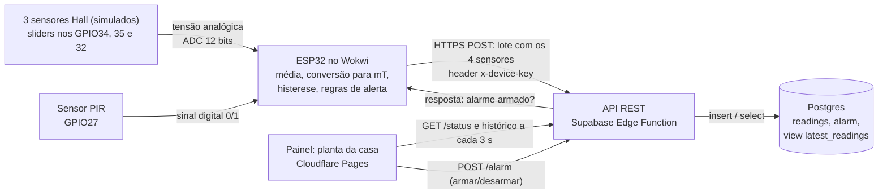

# Sensores para a Segurança Residencial

Monitoramento IoT de uma casa com **3 sensores Hall** (porta de entrada e 2 janelas) e **1 sensor de presença PIR**. Em cada porta ou janela há um ímã na folha e um sensor Hall no batente: fechada significa campo magnético alto, aberta significa campo perto de zero.

O painel mostra a **planta da casa em tempo real**: as portas e janelas deslizam conforme os sensores, e o sensor de presença pulsa quando detecta movimento. Pelo painel também dá para **armar e desarmar o alarme**.

| Item | Link |
|---|---|
| Simulação Wokwi | [Abrir simulação](https://wokwi.com/projects/481506936104773633) |
| Painel publicado | [Abrir painel](https://seguranca-residencial.pages.dev/) |
| Vídeo de demonstração | [Assistir no YouTube](https://youtu.be/f7NLYSfg5Vc) |

## Arquitetura (Opção B: HTTPS direto, sem MQTT)



## Sensores

| `device_id` | Sensor | Pino | Leitura | Estados |
|---|---|---|---|---|
| `porta-entrada` | Hall | GPIO34 | ADC (analógica) | `open` / `closed` |
| `janela-sala` | Hall | GPIO35 | ADC (analógica) | `open` / `closed` |
| `janela-quarto` | Hall | GPIO32 | ADC (analógica) | `open` / `closed` |
| `presenca-sala` | PIR | GPIO27 | digital | `motion` / `clear` |

LEDs: **vermelho** (GPIO26) = alerta ou intrusão; **amarelo** (GPIO25) = alarme armado.

### Regras de alerta (decididas no ESP32)

| Situação | Alarme desarmado | Alarme armado |
|---|---|---|
| Porta ou janela aberta | alerta se ficar aberta por mais de 10 s | alerta imediato (intrusão) |
| Presença detectada | apenas informa | alerta imediato (intrusão) |

## Estrutura

| Pasta | Conteúdo |
|---|---|
| `firmware/` | `main.py` (MicroPython) e `diagram.json` do Wokwi |
| `supabase/migrations/` | Estrutura do banco: `001_readings.sql` (leituras) e `002_multissensor_alarme.sql` (alarme, estados do PIR e view da última leitura de cada sensor) |
| `supabase/functions/readings/` | API REST (Edge Function em Deno/TypeScript) |
| `frontend/` | Painel estático com a planta da casa (`index.html`, sem build) |
| `scripts/` | `teste-api.ps1`, que testa e consulta a API |
| `docs/` | Relatório e roteiro de testes |

## API

Base: `https://<PROJETO>.supabase.co/functions/v1/readings`

| Método | Rota | Descrição |
|---|---|---|
| POST | `/readings` | Recebe **uma leitura ou um lote** (array de até 20). Exige o header `x-device-key`. Resposta 201: `{ "inserted": 4, "armed": false }` |
| GET | `/readings/status` | Última leitura de cada sensor e estado do alarme |
| POST | `/readings/alarm` | Arma ou desarma: `{ "armed": true }` (aberto, sem autenticação, por decisão do projeto acadêmico) |
| GET | `/readings/latest?device_id=porta-entrada` | Leitura mais recente de um sensor |
| GET | `/readings?device_id=porta-entrada&limit=50` | Histórico de um sensor, da mais recente para a mais antiga (máx. 500) |

Exemplo de lote enviado pelo ESP32:

```json
[
  { "device_id": "porta-entrada", "metric": "magnetic_field", "value": 117.9, "unit": "mT", "state": "closed", "alert": false },
  { "device_id": "janela-sala",   "metric": "magnetic_field", "value": 0.0,   "unit": "mT", "state": "open",   "alert": false },
  { "device_id": "janela-quarto", "metric": "magnetic_field", "value": 117.9, "unit": "mT", "state": "closed", "alert": false },
  { "device_id": "presenca-sala", "metric": "presence",       "value": 1,     "unit": "bool", "state": "motion", "alert": false }
]
```

## Como reproduzir

### 1. Banco e API (Supabase)

1. Crie um projeto em <https://supabase.com>.
2. No **SQL Editor**, rode `supabase/migrations/001_readings.sql` e depois `002_multissensor_alarme.sql`.
3. Gere uma chave para o dispositivo. No PowerShell: `[guid]::NewGuid().ToString()`.
4. Em **Edge Functions → Secrets**, crie o secret `DEVICE_KEY` com essa chave.
5. Em **Edge Functions → Deploy a new function → Via Editor**:
   - nome `readings`;
   - cole `supabase/functions/readings/index.ts`;
   - clique em **Deploy**.
6. Na função, desligue **"Verify JWT"**. O POST de leituras é autenticado pela `DEVICE_KEY`.
7. Teste:

   ```powershell
   $env:API_URL = "https://<PROJETO>.supabase.co/functions/v1/readings"
   $env:DEVICE_KEY = "<chave>"
   ./scripts/teste-api.ps1
   ```

### 2. Simulação (Wokwi)

1. Abra <https://wokwi.com/projects/new/micropython-esp32>.
2. Substitua `main.py` e `diagram.json` pelos arquivos de `firmware/`.
3. No `main.py`, troque `API_URL` e `DEVICE_KEY` pelos valores reais **somente no Wokwi**. No GitHub ficam os placeholders.
4. Clique em ▶. O Serial Monitor mostra o estado dos 4 sensores e `POST 201 - 4 leituras`.
5. Para usar:
   - **sliders:** no máximo (cerca de 118 mT) = **fechada**; no meio ou abaixo (cerca de 0 mT) = **aberta**;
   - **PIR:** clique no sensor e use o botão de simular movimento.

### 3. Painel (Cloudflare Pages)

1. Em `frontend/index.html`, ajuste `API_URL`.
2. No Cloudflare, vá em **Workers & Pages → Create → Pages → Upload assets**, dê um nome ao projeto e arraste a pasta `frontend`. Para atualizar depois, faça um novo deploy com a pasta.
3. Para testar localmente, basta abrir `frontend/index.html` no navegador.

## Parâmetros

| Parâmetro | Valor | Onde fica |
|---|---|---|
| Intervalo de coleta | 1 s | `SAMPLE_MS` (firmware) |
| Envio | lote com os 4 sensores a cada 5 s, ou imediato quando algum estado muda | `SEND_MS` (firmware) |
| Histerese | fecha acima de 30 mT, abre abaixo de 20 mT | `CLOSE_MT` / `OPEN_MT` |
| Alerta (desarmado) | aberta por mais de 10 s | `ALERT_OPEN_MS` |
| Dados desatualizados | sem leitura há mais de 30 s | `STALE_MS` (painel) |
| Atualização do painel | a cada 3 s | `POLL_MS` (painel) |

## Segredos

- A `SUPABASE_SERVICE_ROLE_KEY` nunca sai da Supabase; a Edge Function a recebe automaticamente.
- A `DEVICE_KEY` fica nos Secrets da Supabase e no `main.py` do Wokwi. No repositório aparece só o placeholder `COLOQUE_A_DEVICE_KEY_AQUI`.
- Limitações conhecidas:
  - projetos do Wokwi são públicos, então a chave fica visível ali;
  - armar/desarmar não exige login: qualquer pessoa com o link do painel consegue. Foi uma decisão consciente para o trabalho acadêmico; em produção seria necessário autenticar o usuário.

## Integrantes

| Nome | Responsabilidade | Arquivos |
|---|---|---|
| Luiz Henrique | Banco e API (Supabase): configuração da Supabase, testes da API e do Wokwi, publicação do painel no Cloudflare Pages, links e nomes no README | `README.md`, `.gitignore`, `supabase/migrations/`, `supabase/functions/readings/index.ts`, `scripts/teste-api.ps1` |
| Gabriel Ermenegildo | Firmware (ESP32 / Wokwi) | `firmware/diagram.json`, `firmware/main.py` |
| Felipe Dorta | Painel (frontend) | `frontend/index.html` |
| Enzo Tsutsumi | Documentação: relatório, checklist e PDF do relatório | `docs/relatorio.md`, `docs/CHECKLIST.md` |
