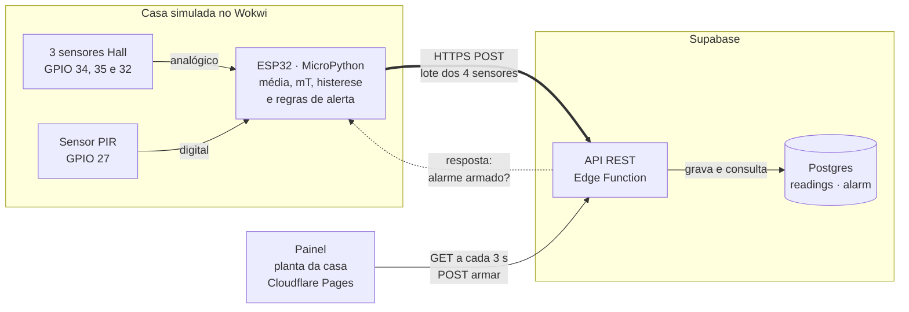

# Sensores para a Segurança Residencial

## Integrantes

- Luiz Henrique Soares Chicareli de Andrade – 2035693
- Enzo Luiz Tsutsumi de Almeida José – 2027602
- Felipe Augusto Santos Dorta de Oliveira – 2052799
- Gabriel Almeida Ermenegildo – 2028344

## Links

- GitHub: https://github.com/luizchicarelli/seguranca-residencial
- Painel: https://seguranca-residencial.pages.dev
- Wokwi: https://wokwi.com/projects/481506936104773633
- Vídeo: https://youtu.be/f7NLYSfg5Vc

## 1. Problema

Portas e janelas abertas sem ninguém perceber, ou movimento dentro de casa com os moradores fora, são riscos de segurança residencial.

O sistema monitora uma casa com:

- três sensores de efeito Hall: porta de entrada, janela da sala e janela do quarto;
- um sensor de presença PIR, na sala.

Em cada porta ou janela, um ímã é preso à folha e o sensor Hall ao batente:

- fechada: o ímã está próximo, e o campo magnético é alto (dezenas de mT);
- aberta: o ímã está longe, e o campo fica perto de zero.

Os eventos aparecem numa planta da casa em tempo real, e o morador pode armar o alarme pelo painel.

| Parâmetro | Valor |
| --- | --- |
| Grandezas monitoradas | campo magnético (mT) com o estado aberta/fechada; presença (0/1) |
| Intervalo de coleta | 1 s. Envio a cada 5 s, ou imediato quando algum estado muda |
| Alerta (alarme desarmado) | porta ou janela aberta por mais de 10 s |
| Alerta (alarme armado) | qualquer abertura ou presença gera **intrusão** imediata |

O Wokwi não possui um componente de sensor Hall. A saída analógica de um Hall linear (modelo SS49E) foi simulada com potenciômetros deslizantes, que produzem a mesma faixa de tensão (0 a 3,3 V).

## 2. Arquitetura

Usamos a Opção B, com HTTPS direto e sem MQTT:

- **Dispositivo → nuvem:** ESP32 + sensores (Wokwi) → **HTTPS POST com os 4 sensores em lote** → API REST (Supabase Edge Function) → Postgres (Supabase).
- **Painel:** a planta da casa (Cloudflare Pages) consulta a API por **HTTPS GET** a cada 3 s e arma/desarma o alarme por **POST**.
- **Nuvem → dispositivo:** a **resposta** de cada POST informa ao ESP32 se o alarme está armado.

Com isso existe comunicação nos dois sentidos sem broker MQTT. A desvantagem é que o comando de armar chega ao ESP32 só no próximo envio, depois de alguns segundos.

## 3. Funcionamento

**Comunicação ESP32 ↔ sensores: leitura analógica × digital.**

- **Sensores Hall (analógicos):** geram uma tensão proporcional ao campo, V = 1,65 V + 0,014 V/mT × B. Ela é lida pelo **ADC1 do ESP32**, um conversor SAR de **12 bits** (0–3,3 V → 0–4095, cerca de 0,8 mV por passo), nos pinos GPIO34, 35 e 32. Usamos só o ADC1 porque o ADC2 é compartilhado com o rádio Wi-Fi.
- **PIR (digital):** entrega o sinal pronto (0 = sem movimento, 1 = movimento), lido direto do registrador de entrada do GPIO27, sem conversão.

A leitura digital é imediata e não tem ruído de conversão. A analógica permite medir intensidade e decidir o estado no software.

**Processamento na borda (ESP32).** A cada coleta, para cada sensor Hall, o firmware:

1. faz a média de 8 amostras, para reduzir ruído;
2. converte o valor em tensão e depois em mT;
3. aplica histerese: fecha acima de 30 mT e abre abaixo de 20 mT. Com um limite único, pequenas variações fariam o estado oscilar;
4. aplica a regra de alerta, de acordo com o alarme estar armado ou não, usando `time.ticks_ms()` para medir o tempo de abertura.

Os LEDs mostram o estado no próprio dispositivo: vermelho = alerta ou intrusão, amarelo = alarme armado. Decidir no dispositivo permite reagir mesmo sem rede.

O firmware foi escrito em MicroPython, um interpretador Python que roda no microcontrolador. É mais simples de escrever que C++, mas é interpretado (mais lento) e ocupa parte da RAM. Para sensores amostrados a cada 1 s, esse custo não faz diferença.

**Arquitetura do ESP32 e custo da comunicação.** O ESP32 tem dois núcleos Xtensa LX6. A pilha WiFi/TCP/IP roda em tarefas do FreeRTOS, e o MicroPython executa o nosso laço principal em uma delas. O handshake TLS de cada requisição HTTPS consome bastante CPU (criptografia assimétrica) e dezenas de kB de RAM, e leva alguns segundos no simulador. Por isso os 4 sensores são enviados em lote, num único POST: um só handshake por ciclo (cerca de 6 a 10 s), em vez de quatro (cerca de 20 s).

**API REST (Supabase Edge Function).**

- `POST /readings`: autentica o dispositivo pelo header `x-device-key`, valida cada leitura (`device_id`, `metric`, `value`, `unit`, `state`, `alert`), grava o lote e responde com o estado do alarme.
- `GET /readings/status`: última leitura de cada sensor e estado do alarme, para a planta.
- `GET /readings?device_id=…`: histórico de um sensor. `GET /readings/latest`: leitura mais recente.
- `POST /readings/alarm`: arma ou desarma o alarme.

O horário de cada leitura é atribuído pelo servidor (`created_at`), porque o ESP32 não tem relógio de tempo real sincronizado.

**Armazenamento.**

- Tabela `readings`: todas as leituras, com índice em (`device_id`, `created_at` desc).
- Tabela `alarm`: uma única linha, armado sim/não.
- View `latest_readings`: a última leitura de cada sensor numa só consulta.

O RLS está ativo e sem policies, então só a API acessa o banco. Como a gravação ocorre na API, os dados são armazenados mesmo com o painel fechado.

**Painel.** A planta da casa é desenhada em SVG:

- cada porta ou janela muda de cor: verde = fechada, laranja = aberta, vermelho piscando = alerta;
- ao abrir, a folha desliza para dentro da parede;
- o sensor de presença pulsa quando detecta movimento;
- o painel mostra o valor, a unidade e o horário da última leitura de cada sensor;
- clicando num sensor, aparecem o gráfico e a tabela só daquele sensor.

Se a leitura mais recente tiver mais de 30 s, o painel mostra "DADOS DESATUALIZADOS" e esmaece a planta. Quando chegam leituras novas, ele volta ao normal sozinho.

**Efeito do intervalo de coleta e envio.**

| | Intervalo menor | Intervalo maior |
| --- | --- | --- |
| Detecção | mais rápida | uma abertura rápida pode passar despercebida |
| Custo | mais requisições, mais linhas no banco, mais energia (rádio e TLS) | menos carga |

A solução combina coleta de 1 s, envio periódico de 5 s e envio imediato na mudança de estado. Na prática, o intervalo medido foi de 6 a 10 s, porque o laço fica bloqueado durante o handshake TLS. Por isso o limite de "desatualizado" é de 30 s. Melhorias possíveis: reaproveitar a conexão (keep-alive) ou enviar em uma tarefa do FreeRTOS no outro núcleo.

## 4. Testes

| Teste | Procedimento | Resultado |
| --- | --- | --- |
| Fluxo completo | Mover o slider da porta no Wokwi e observar os Logs da Edge Function e a planta | POST 201 - 4 leituras; a porta desliza na planta |
| Vários sensores | Mexer em cada slider e simular movimento no PIR | Cada porta ou janela e o PIR reagem na planta |
| Alerta (desarmado) | Deixar uma janela aberta por mais de 10 s | Janela vermelha, faixa "ALERTA" e LED vermelho |
| Armar alarme | Clicar em "Armar alarme" no painel | LED amarelo acende no próximo envio |
| Intrusão | Com o alarme armado, abrir uma janela ou acionar o PIR | Faixa "INTRUSÃO DETECTADA" e LED vermelho, sem esperar 10 s |
| Interrupção e retomada | Pausar a simulação e depois retomar | "DADOS DESATUALIZADOS" após ~30 s; volta a "Online" |
| Painel fechado | Gerar leituras com o painel fechado e consultar `GET /readings/status` | Leituras gravadas e visíveis ao reabrir |
| Segurança | POST com a chave errada | 401 Não Autorizado |

## 5. Limitações

- Os sensores Hall foram simulados por potenciômetros. A calibração (`V_ZERO`, sensibilidade) precisa ser ajustada com sensores reais.
- O HTTPS no ESP32 criptografa a conexão, mas não valida o certificado do servidor.
- O projeto do Wokwi é público, então a chave do dispositivo fica visível ali. Ela só permite inserir leituras e deve ser trocada.
- A consulta e o armar/desarmar não exigem login: qualquer pessoa com o link do painel consegue. Foi uma decisão consciente para o trabalho acadêmico.
- O comando de armar chega ao ESP32 só no próximo envio (alguns segundos). Com MQTT, ele chegaria imediatamente.
- O painel usa polling a cada 3 s, não push. O cálculo de "desatualizado" depende do relógio de quem vê o painel.
- O sistema não detecta sabotagem, como um ímã externo encostado no sensor.

## 6. Contribuições

| Integrante | Contribuição |
| --- | --- |
| Luiz Henrique Soares Chicareli de Andrade | Banco de dados (Supabase), API REST (Edge Function), script de testes, configuração dos serviços e publicação do painel no Cloudflare Pages |
| Gabriel Almeida Ermenegildo | Firmware MicroPython do ESP32 e circuito no Wokwi (sensores, histerese, alarme e envio em lote) |
| Felipe Augusto Santos Dorta de Oliveira | Painel web: planta da casa, alarme, histórico por sensor e aviso de dados desatualizados |
| Enzo Luiz Tsutsumi de Almeida José | Relatório, roteiro e execução dos testes e vídeo de demonstração |
